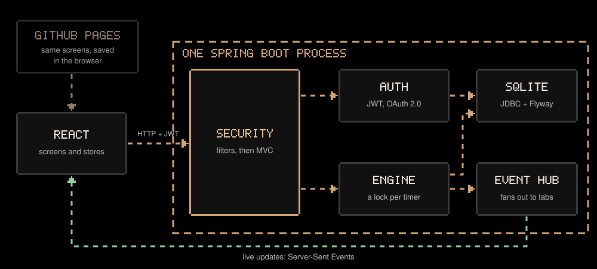
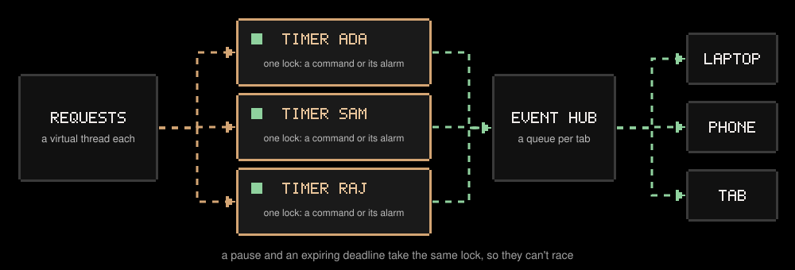
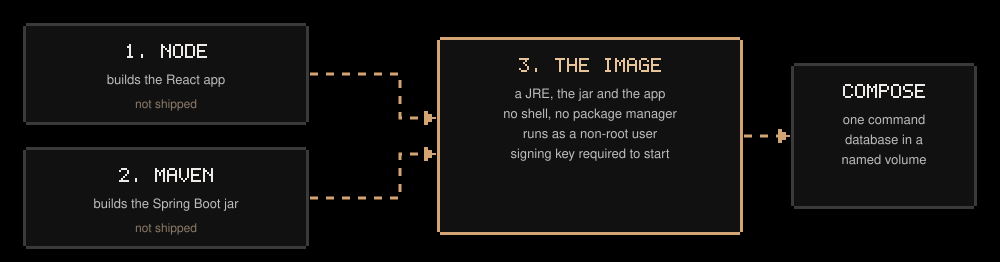

<p align="center"></p>

A pomodoro timer and productivity tracker with a Spring Boot backend and a React frontend. Timers run on the server, so a session keeps going when you close the tab and stays in sync across every device you're signed in on. You can sign in with a password, or with Google or GitHub over OAuth 2.0.

**[Try it in your browser](https://hrushibhatt.github.io/BrewFocus/)**, or run the full app with Docker:

```bash
cp .env.example .env                 # then set JWT_SECRET: openssl rand -hex 32
docker compose up --build            # http://localhost:5001
```




The reasoning behind every choice below is in **[DESIGN.md](DESIGN.md)**.

## Why Spring Boot

A timer app looks simple, but it has a hard requirement: many timers running at once, each of which can be paused from any device at the exact moment it expires, and every account guarded properly. Spring Boot gives me well-tested answers for the security half, and Java 21's virtual threads make the concurrency half cheap.



| Tool | What it does here | Why it fits |
|---|---|---|
| **Spring MVC on virtual threads** | Routes, JSON, validation, the event stream | Each request and each open stream gets its own cheap thread, so blocking code stays simple |
| **Spring Security** | The filter chain: headers, CSRF, sessions, authorization | The sensitive parts use a framework with years of review behind it, not code I wrote from scratch |
| **Spring Security OAuth 2.0 Client** | Sign-in with Google and GitHub | State, PKCE and ID-token checks come built in; I only decide which account a sign-in opens |
| **Nimbus JOSE + JWT** | Signs and verifies session tokens | The same library Spring Security uses, with the algorithm pinned |
| **JdbcClient, Flyway, SQLite** | Tables, queries and migrations | No database server to run, the SQL stays readable, and every value is a bound parameter |
| **Bean Validation** | Request bodies | Each rule and its error message sit next to the field they check |
| **SmartLifecycle** | Start and stop order | Timers resume before the first request, and streams close before shutdown waits on them |
| **JUnit 5, AssertJ, Mockito** | 70 unit tests and 42 integration tests | The integration tests drive a real server on a random port, including a full OAuth 2.0 sign-in |

## Why React

| Tool | What it does here | Why it fits |
|---|---|---|
| **React 19, function components** | Every screen | Small, focused components, each with its own stylesheet |
| **Zustand** | The timer, the session flow, the account | Most updates arrive from the server's event stream, not from a click, so state lives outside React |
| **React Router** | Brew, Progress and Login pages | Pages load on demand, and signed-out visitors land on sign-in |
| **Vite** | Dev server and builds | One flag swaps the backend for the in-browser store that GitHub Pages runs |
| **Vitest, Testing Library, Playwright** | 55 unit tests and 20 browser tests | Components are tested the way people use them, and the browser tests run both builds for real |

The frontend is plain JavaScript with JSDoc types. The original pixel-art stylesheets carried over unchanged, scoped to each component.

## The timer engine



Each timer has its own lock, and both its commands and its alarm take that lock, so a pause and an expiring deadline are applied one after the other. One scheduler thread keeps time for every timer, and each expiry runs on its own virtual thread, so a slow database write can't delay anyone else's deadline. See [`TimerEngine`](backend/src/main/java/io/github/hrushibhatt/brewfocus/timer/TimerEngine.java).

Updates reach the browser over Server-Sent Events rather than WebSockets. Clients only listen, since commands go over normal HTTP, and browsers reconnect to SSE on their own. Each tab gets a small queue, and a tab that falls too far behind is dropped instead of slowing everyone else.

## Sign-in: JWT and OAuth 2.0



| Choice | Why |
|---|---|
| JWT in an HttpOnly cookie, not `localStorage` | An injected script can't read it, so it can't steal it |
| A session row behind each JWT | A JWT alone can't be taken back before it expires. Deleting the row makes logging out instant |
| OAuth 2.0 authorization code flow with PKCE | The provider's code is useless to anyone who intercepts it without the verifier |
| An OAuth sign-in ends in the same JWT cookie | Everything after sign-in works the same, however you signed in |
| Provider tokens are thrown away | I only need to know who you are, not to act on your Google or GitHub account |
| No merging accounts by email | Sign-up doesn't verify emails, so merging would let someone pre-register your address and wait |
| The server won't start in production without a strong key | A guessable key would let anyone forge a session |

To turn on Google or GitHub sign-in, register an OAuth app with the provider and put its client ID and secret in `.env` (see [`.env.example`](.env.example)). A provider's button appears only once both are set.


## Docker



The multi-stage build uses Node, Maven and the JDK but ships none of them. The final image is a distroless Java runtime: no shell or package manager for an attacker to use. Compose keeps the database in a named volume, and runs the container read-only with no extra privileges.

## Two ways to run, one set of screens

GitHub Pages only serves static files, so it can't run Java. The [Pages build](https://hrushibhatt.github.io/BrewFocus/) swaps the server for an in-browser store that answers the same `/api` calls and saves to `localStorage`.

| | Spring Boot server | GitHub Pages |
|---|---|---|
| **Sign-in** | Password, Google or GitHub | None needed |
| **Data** | SQLite on the server | This browser only |
| **Timers** | Run on the server | Saved deadline, in the browser |
| **Sync** | Every device | Tabs in one browser |
| **Runs on** | Docker, or any server with Java 21 | Static hosting |

The screens can't tell which one they're talking to, so there's only one UI to maintain.

## A deadline, not a counter


Timers save when they end rather than counting down. A background tab, a closed laptop or a server restart can't lose time, and a block that ran out during a restart is credited when the server comes back.

## One flow for every block


An intention gives a block a purpose, and a reflection makes it count for more than minutes.


## Security



Tests cover each of these, including forged JWTs, a forged OAuth callback, and one user reaching for another's data.

## Kept simple on purpose



This app once had Google Calendar and an AI planner. They were removed because a timer doesn't need them. The move to Spring Boot and React added OAuth 2.0 and more tests, and Java is wordier than Go, but the backend is still only what a timer and tracker require.



## Every push is tested



A failed check leaves the live site as it was. The Docker image is built and scanned alongside, on its own, so a newly published vulnerability in a base image can't take the site offline. CodeQL scans the Java and the JavaScript on every push.

## The code

```
backend/src/main/java/.../brewfocus/
  account/             sign-up, sign-in, passwords, settings
  security/            the filter chain, JWT sessions, CSRF, headers
    oauth/             OAuth 2.0 providers and which account a sign-in opens
    ratelimit/         rate limits and client addresses
  timer/               the server-run timers
  events/              live updates to every open tab
  preset/, task/       custom modes and tasks
  journal/             finished sessions and the stats built from them
  web/, config/        errors, validation, static files, the database
backend/src/main/resources/db/migration/   the schema, versioned by Flyway
backend/src/test/      unit tests (*Test) and integration tests (*IT)
frontend/src/
  api/                 the API client and the live event stream
  state/               Zustand stores: auth, timer, the session flow, theme, ambience
  browser/             the in-browser store, for the Pages build only
  features/            brew, tasks, focus, progress, settings, login
  components/          dialog frame and pixel art
frontend/e2e/          browser tests against the Spring Boot server
frontend/e2e-pages/    browser tests against the Pages build
```

Every package and module starts with a comment explaining its design decisions.

| Command | What it does |
|---|---|
| `make install` | Download dependencies (Java 21 and Node 24 needed) |
| `make api` and `make web` | Run the API on :5001 and the app on :4200 |
| `make serve` | Build everything and serve it from one Spring Boot process on :5001 |
| `make docker` | Run the app with Docker Compose |
| `make test` | Backend unit and integration tests, then frontend lint and unit tests |
| `make e2e` | Browser tests against the real Spring Boot server |
| `make audit` | Dependency and secret scans |
| `make pages` | Run the browser-only build |

[Design decisions](DESIGN.md) · [Changelog](CHANGELOG.md)
